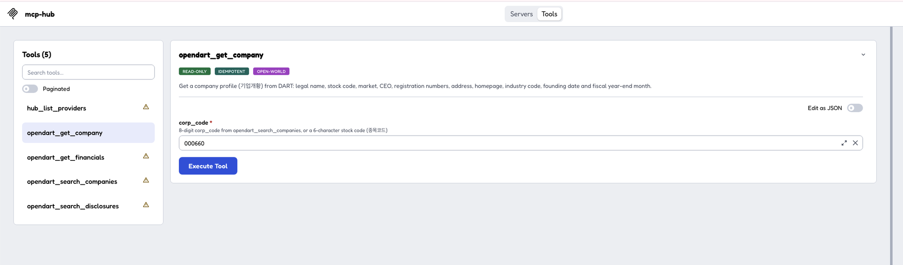
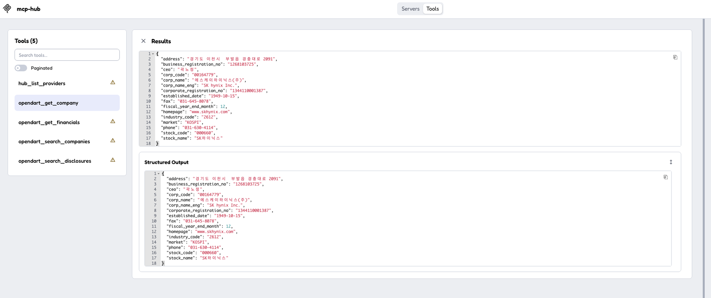
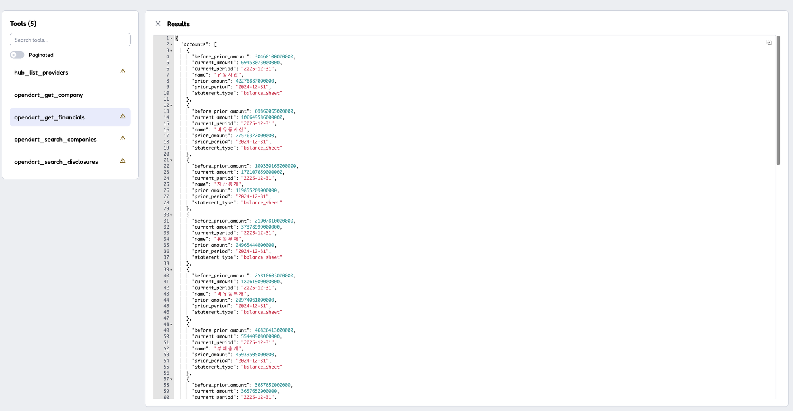

# mcp-hub

**English** | [한국어](README.ko.md)

Asian public and financial data, **starting with Korea**, served as **MCP servers that all follow one consistent specification**, so AI agents anywhere can use it without dealing with each source's quirks.

## Why mcp-hub

Korean public APIs are free and official, but calling them directly is full of traps. Some of them don't even fail; they just give the agent a wrong answer.

**Example:** "What was Samsung Electronics' revenue in the first half of 2025?" Here is what OpenDART actually returns:

```json
{ "account_nm": "매출액", "thstrm_dt": "2025.01.01 ~ 2025.06.30",
  "thstrm_amount": "74,566,317,000,000", "thstrm_add_amount": "153,706,820,000,000" }
```

The period says January to June, so an agent reads `thstrm_amount` and answers **₩74.6 trillion. That is wrong**: it is the second quarter only. The half-year figure, ₩153.7 trillion, is in a different field. mcp-hub returns:

```json
{ "name": "매출액", "statement_type": "income_statement",
  "current_period": "2025-01-01 ~ 2025-06-30",
  "current_amount": 153706820000000, "current_quarter_amount": 74566317000000 }
```

The same goes for everything else an agent would otherwise stumble on:

- **Outdated data that looks current.** The government company registry returns 19 unordered records for Samsung Electronics, including ones that name a former CEO. mcp-hub uses only the latest record and says how recent it is (`as_of`).
- **Records that should not count.** Apartment trade data keeps cancelled deals, marked only by a flag: 12 of 233 Gangnam trades in September 2025, including a ₩7.5 billion one. Averages that include them are wrong. mcp-hub leaves them out of the summary.
- **Codes that quietly stop working.** In 2026, 광주광역시 and 전라남도 merged, 화성시 was split into four 구, and 인천 reorganized its 중구, 동구 and 서구. The old district codes, which most code tables and blog posts still list, now return zero apartment trades, **even for past months**: the history moved to the new codes. With mcp-hub, an agent just says `광주 북구` or `화성시`.
- **Inputs that silently fail.** Ask the National Tax Service about `124-81-00998`, Samsung Electronics' number written the usual way, and it says the number is not registered. mcp-hub normalizes the format first. Ask the stock price API for `POSCO홀딩스` by name and two years of history are missing, because before the 2022 rename the rows say `POSCO`. mcp-hub always queries by code.
- **Errors that look like success.** OpenDART reports a bad key or an exceeded quota as HTTP 200. data.go.kr returns zero results, not an error, for an invalid parameter. mcp-hub turns these into [one error format](docs/CONVENTIONS.md#6-errors) with a `hint` the agent can act on.
- **A different format for every API.** Result codes `00` vs `000`, a single result as an object instead of an array, amounts like `"84,500"` meaning ₩845,000,000, dates like `25.11.28`. mcp-hub always returns typed numbers, ISO dates, and `page`/`page_size` pagination.
- **Missing basics.** OpenDART has no company search. mcp-hub indexes all ~120,000 companies, so `삼성전자`, `samsung electronics`, or the stock code `005930` all work.
- **Connection issues.** OpenDART fails with `tls: handshake failure` from Go clients. mcp-hub handles it.

Every item was found on the live APIs and is covered by a test that uses the real response. See the full list: **[What mcp-hub handles for you](docs/QUIRKS.md)**.

## Running

```sh
go build -o mcp-hub ./cmd/mcp-hub

./mcp-hub                       # stdio (Claude Desktop, Claude Code, etc.)
./mcp-hub -http :8080           # streamable HTTP
./mcp-hub -providers opendart   # enable only specific providers
./mcp-hub -env-file .env        # read API keys from a .env file
```

## API key setup

API keys are set through environment variables. A provider whose keys are missing is disabled automatically, and the `hub_list_providers` tool shows which keys are missing. Use each key exactly as issued.

| Environment variable | Provider | Where to get it |
|---|---|---|
| `OPENDART_API_KEY` | OpenDART (전자공시, corporate disclosures) | https://opendart.fss.or.kr → 인증키 신청 (request an API key) |
| `DATAGOKR_SERVICE_KEY` | data.go.kr (공공데이터포털, Public Data Portal) | https://www.data.go.kr → 활용신청 (apply for use) → My Page |

> **data.go.kr note**: The portal issues two keys, Encoding and Decoding. Use the **Decoding key**. The Encoding key gets URL-encoded twice and fails with `SERVICE_KEY_IS_NOT_REGISTERED_ERROR`.

### Option 1: In your MCP client configuration

Claude Code:

```sh
claude mcp add mcp-hub \
  -e OPENDART_API_KEY=... \
  -e DATAGOKR_SERVICE_KEY=... \
  -- /path/to/mcp-hub
```

Claude Desktop and other clients configured with JSON:

```json
{
  "mcpServers": {
    "mcp-hub": {
      "command": "/path/to/mcp-hub",
      "env": { "OPENDART_API_KEY": "...", "DATAGOKR_SERVICE_KEY": "..." }
    }
  }
}
```

### Option 2: A `.env` file

```sh
cp .env.example .env    # then fill in the values
./mcp-hub -env-file /absolute/path/to/.env
```

- Use an **absolute path**, because MCP clients do not launch servers from a predictable working directory.
- The format is `KEY=VALUE`, with support for `#` comments, an `export ` prefix, and quoted values.
- If the same variable is also set (non-empty) in the shell or the client configuration, **that value takes precedence**.
- `.env` is listed in `.gitignore`. Do not commit it.

## Tools

Call `hub_list_providers` to see which providers are enabled and which keys are missing.

**OpenDART** (`OPENDART_API_KEY`)

| Tool | What it does |
|---|---|
| `opendart_search_companies` | Find a company's `corp_code` by Korean/English name, stock code, or corp_code |
| `opendart_get_company` | Company profile (기업개황): CEO, market, registration numbers, address, fiscal year-end |
| `opendart_search_disclosures` | Search disclosures (공시) by company, date range, type, and market |
| `opendart_get_financials` | Key financial accounts (주요계정) for a year and report, with prior-period comparisons |

Every OpenDART tool that takes `corp_code` also accepts a 6-character stock code (e.g. `005930`).

**data.go.kr** (`DATAGOKR_SERVICE_KEY`). Each API needs its own application (활用신청) on data.go.kr; the links are below.

| Tool | What it does | API to apply for |
|---|---|---|
| `datagokr_list_holidays` | Public holidays (공휴일) for a year or month, including substitute holidays, Seollal and Chuseok, and election days, with English names and weekdays. Also anniversaries, the 24 solar terms, and seasonal days. 2004 through two years ahead | [한국천문연구원_특일 정보](https://www.data.go.kr/data/15012690/openapi.do) |
| `datagokr_search_corporations` | Find Korean corporations by name, listed or not. Returns the corporate registration number (`crno`) and, for DART filers, `dart_corp_code` for opendart tools | [금융위원회_기업기본정보](https://www.data.go.kr/data/15043184/openapi.do) |
| `datagokr_get_corporation` | Current company profile: CEO, market, registration numbers, founding and listing dates, address, industry, employees, average tenure and salary, auditor and audit opinion | Same as above |
| `datagokr_check_business_status` | Check up to 100 business registration numbers (사업자등록번호) with the National Tax Service: registered or not, active, suspended or closed (with date), and VAT type. Hyphens are fine | [국세청_사업자등록정보 진위확인 및 상태조회](https://www.data.go.kr/data/15081808/openapi.do) |
| `datagokr_list_apartment_trades` | Apartment sale transactions for a district and month, newest first, with a median/min/max price summary. Prices in KRW; cancelled deals excluded by default; filter by apartment name or neighborhood. The region is a name (`강남구`, `서울 중구`, `분당구`, `광주 북구`) or a 5-digit code; a city with wards, such as `수원시` or `화성시`, covers all of them | [국토교통부_아파트 매매 실거래가 자료](https://www.data.go.kr/data/15126469/openapi.do) |
| `datagokr_get_stock_prices` | Daily prices of a KOSPI, KOSDAQ or KONEX stock: close, change, open/high/low, volume, trading value, market cap. The stock is a name (`삼성전자`, `naver`), a 6-digit code or an ISIN; history follows the code across renames. Since 2020 | [금융위원회_주식시세정보](https://www.data.go.kr/data/15094808/openapi.do) |

## Testing locally

### 1. Unit tests (no API key needed)

```sh
go test -race ./...
go test -race -v -run TestGetFinancials ./providers/opendart   # a single test
```

The tests use real upstream responses saved under each provider's `testdata/` and a fake upstream server, so they need no network or keys.

### 2. MCP Inspector (call tools against the live API)

[MCP Inspector](https://github.com/modelcontextprotocol/inspector) is the official MCP debugging UI. It requires Node.js.

```sh
go build -o mcp-hub ./cmd/mcp-hub
npx @modelcontextprotocol/inspector -- ./mcp-hub -env-file $PWD/.env
```

> Keep the `--`. Without it, Inspector reads `-env-file` as its own `-e` option and fails with `Invalid parameter format: nv-file`.

Alternatively, run `npx @modelcontextprotocol/inspector` with no arguments and fill in the left panel: **Transport Type** `STDIO`, **Command** the absolute path to `mcp-hub`, **Arguments** `-env-file /absolute/path/to/.env`.

Then:

1. Click **Connect**, open the **Tools** tab, and click **List Tools**.
2. Pick a tool, fill in its inputs, and click **Execute Tool**. For example, `opendart_get_company` with `corp_code` = `000660` (SK hynix):



3. The result appears under **Results** and **Structured Output**:



4. Try the other tools the same way. For example, `opendart_get_financials` with `corp_code` = `000660` and `year` = `2025` returns key accounts with amounts in KRW as plain numbers, ISO dates, and prior-period comparisons:



`corp_code` takes a code, not a company name. Use `005930` (Samsung Electronics), `000660` (SK hynix), or `035720` (Kakao), or find one first with `opendart_search_companies` (`query` = `삼성전자` or `samsung electronics`). Passing a name returns `INVALID_ARGUMENT` with a hint, which is a quick way to see the error format.

The first company lookup takes a few seconds, because it downloads DART's full company list (about 120,000 entries) and builds an in-memory index. Later lookups are instant for 24 hours.

### 3. Claude Code (use it from a real agent)

```sh
claude mcp add mcp-hub -- /absolute/path/to/mcp-hub -env-file /absolute/path/to/.env
```

Start a new session, check the connection with `/mcp`, and ask something like "What were Samsung Electronics' revenue in the first half of 2025 and its latest disclosures?". This shows whether an agent picks the right tools and arguments from the descriptions alone.

### 4. HTTP mode

```sh
./mcp-hub -http :8080 -env-file .env
```

In Inspector, set **Transport Type** to `Streamable HTTP` and the URL to `http://localhost:8080`.

Server logs go to stderr. Add `-v` for debug logs.

## Layout

| Path | Purpose |
|---|---|
| `hub/` | Provider registration, tool naming rules, standard errors, pagination |
| `httpx/` | Upstream HTTP client (retries, caching, error mapping, API key redaction) |
| `normalize/` | Normalization of dates, amounts, and HTML text |
| `cache/` | In-memory TTL cache |
| `providers/` | List of providers |
| `cmd/mcp-hub/` | Executable |

When adding a provider, follow [docs/CONVENTIONS.md](docs/CONVENTIONS.md).

## Provider roadmap

- [x] OpenDART (전자공시, corporate disclosures): verified against the live API
- [x] data.go.kr: verified against the live API
  - [x] Public holidays (특일 정보): verified against the live API
  - [x] Company information (기업기본정보): verified against the live API
  - [x] Business registration status (사업자등록 상태조회): verified against the live API
  - [x] Apartment trade prices (아파트 매매 실거래가): verified against the live API, with district names
  - [x] Stock prices (주식시세): verified against the live API
- [ ] 국가법령정보 (Korean Law Information Center)
- [ ] Bank of Korea ECOS, KOSIS (Korean Statistical Information Service)
- [ ] Next region: Japan EDINET (corporate disclosures)
