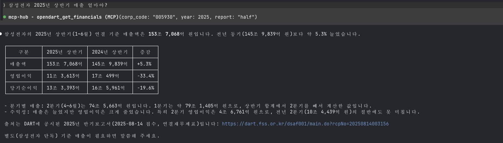
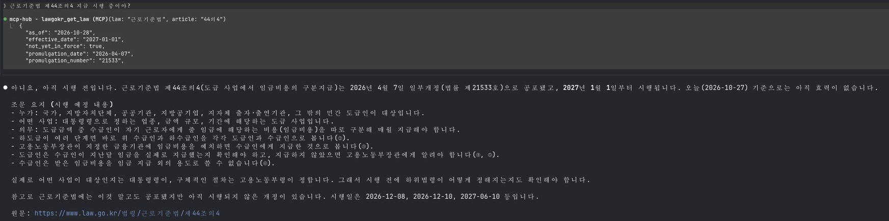

# korea-data-mcp

**English** | [한국어](README.ko.md)

[](https://github.com/YoungsoonLee/korea-data-mcp/releases/latest)
[](LICENSE)
[](go.mod)

**Pass Korean public APIs straight to an AI agent and it gets answers wrong. korea-data-mcp gives it the right ones.**

An MCP server for Korean corporate filings and financials, stock prices, apartment sale prices and rents, business registration status, public holidays, statutes and court rulings, from the official free APIs of OpenDART, data.go.kr and law.go.kr.

- **Correct, with evidence.** 47 traps found on the live APIs (wrong half-year revenue, laws not in force yet, cancelled deals, district codes that changed in 2026, and more) are handled, each covered by a test that uses the real response. The full list is public: [What korea-data-mcp handles for you](docs/QUIRKS.md). In a [small evaluation](eval/RESULTS.md), agents with korea-data-mcp answered 10 of 10 questions with one call each; with the raw APIs they hit the traps, needed about 3x the calls, and missed one.
- **Installs in one click.** A single binary with nothing else to install. In Claude Desktop, open [korea-data-mcp.mcpb](https://github.com/YoungsoonLee/korea-data-mcp/releases/latest/download/korea-data-mcp.mcpb) and enter your keys. Also in the [official MCP Registry](https://registry.modelcontextprotocol.io/v0.1/servers?search=io.github.YoungsoonLee/korea-data-mcp).
- **Private.** It runs on your machine. Your keys and questions go only to the government APIs, never through a third-party server, and there is no telemetry.
- **Focused.** 16 tools with clear descriptions, so an agent picks the right one without filling its context with dozens of others.

## Why it matters

**Example:** "What was Samsung Electronics' revenue in the first half of 2025?" Here is what OpenDART actually returns:

```json
{ "account_nm": "매출액", "thstrm_dt": "2025.01.01 ~ 2025.06.30",
  "thstrm_amount": "74,566,317,000,000", "thstrm_add_amount": "153,706,820,000,000" }
```

The period says January to June, so an agent reads `thstrm_amount` and answers **₩74.6 trillion. That is wrong**: it is the second quarter only. The half-year figure, ₩153.7 trillion, is in a different field. Most Korean MCP servers pass this response on as is. korea-data-mcp returns:

```json
{ "name": "매출액", "statement_type": "income_statement",
  "current_period": "2025-01-01 ~ 2025-06-30",
  "current_amount": 153706820000000, "current_quarter_amount": 74566317000000 }
```

So the agent gets it right, and can even split out the second quarter:



Three more traps, each of which silently produces a wrong answer:

- **Law that is not law yet.** Ask law.go.kr for the current Labor Standards Act (근로기준법) and the text includes 제44조의4, labeled as in effect since 2026-10-08. It actually takes effect on **2027-01-01**; the official "current law" text already contains amendments that are only promulgated. korea-data-mcp returns the text in force on the date you ask for (today by default) and lists what is coming in `upcoming` (tool output shortened):

  

- **Deals that never happened.** Apartment trade data keeps cancelled deals, marked only by a flag: 12 of 233 Gangnam trades in September 2025, including a ₩7.5 billion one. Averages that include them are wrong. korea-data-mcp leaves them out.
- **Codes that quietly stop working.** In 2026, 광주광역시 and 전라남도 merged, 화성시 was split into four 구, and 인천 reorganized its districts. The old district codes, which most code tables still list, now return zero trades, **even for past months**. With korea-data-mcp, an agent just says `광주 북구` or `화성시`.

There is more: errors returned as HTTP 200, stale records mixed with current ones, business numbers that fail when written with hyphens, stock history split by a company rename, and a TLS handshake that fails from Go. See all 47: **[What korea-data-mcp handles for you](docs/QUIRKS.md)**.

## What you can ask

Connect korea-data-mcp to Claude (or any MCP client) and ask in English or Korean:

- "What was Samsung Electronics' revenue in the first half of 2025, and what has it disclosed recently?"
- "What was the median apartment sale price in 분당구 in September 2025?"
- "What was the median jeonse deposit for new contracts in 강남구 in September 2025?"
- "Is 제44조의4 of the Labor Standards Act (근로기준법) in force yet?"
- "Find recent Supreme Court rulings on unfair dismissal (부당해고) and summarize the holding of the latest one."
- "Is business registration number 124-81-00998 still active?"
- "How did NAVER's stock price move last month?"
- "Which public holidays are left in Korea this year?"

| Source | What it covers | Key |
|---|---|---|
| [OpenDART](https://opendart.fss.or.kr) (전자공시) | Company profiles, disclosures, financial statements of ~120,000 companies | `OPENDART_API_KEY` |
| [data.go.kr](https://www.data.go.kr) (공공데이터포털) | Holidays, corporation info, business status, apartment trades, stock prices | `DATAGOKR_SERVICE_KEY` |
| [law.go.kr](https://open.law.go.kr) (국가법령정보) | Statutes as in force on any date, court rulings | `LAWGOKR_OC` |

All three keys are free. You can start with just one.

## Quick start

> **Claude Desktop, in one click:** download [korea-data-mcp.mcpb](https://github.com/YoungsoonLee/korea-data-mcp/releases/latest/download/korea-data-mcp.mcpb), open it (or drag it into Settings → Extensions), and enter the keys you have ([how to get them](#api-keys)). Nothing else to install; skip to [step 4](#4-check-it).

### 1. Install

**Download a binary** for macOS, Linux or Windows (Intel or ARM) from [Releases](https://github.com/YoungsoonLee/korea-data-mcp/releases/latest), extract it, and note the absolute path of `korea-data-mcp` (`korea-data-mcp.exe` on Windows). For example, on an Apple Silicon Mac:

```sh
curl -L https://github.com/YoungsoonLee/korea-data-mcp/releases/latest/download/korea-data-mcp_darwin_arm64.tar.gz | tar xz
./korea-data-mcp -version
```

On macOS, a binary downloaded with a browser is blocked as coming from an unidentified developer; run `xattr -d com.apple.quarantine korea-data-mcp` once. `curl` downloads are not affected.

**Or with Go** 1.26 or later (Go 1.21+ downloads the right toolchain automatically):

```sh
go install github.com/YoungsoonLee/korea-data-mcp/cmd/korea-data-mcp@latest
```

The binary is installed to `$(go env GOPATH)/bin/korea-data-mcp`.

### 2. Get a key

Start with **OpenDART**: sign up at [opendart.fss.or.kr](https://opendart.fss.or.kr), request a key (인증키 신청), and it is issued right away. For all three, step by step with the Korean menu names: **[Getting API keys](docs/KEYS.md)**. Any subset works; tools whose key is missing are simply not offered.

> **Outside Korea?** These portals usually require Korean identity verification (a Korean mobile number) to sign up, so getting keys from abroad can be hard or impossible. A hosted version that needs no keys of your own is planned: **[join the waitlist](https://github.com/YoungsoonLee/korea-data-mcp/issues/new?template=hosted-access.yml)**.

### 3. Connect your client

Use absolute paths. Leave out the keys you don't have.

**Claude Code:**

```sh
claude mcp add korea-data-mcp \
  -e OPENDART_API_KEY=... \
  -e DATAGOKR_SERVICE_KEY=... \
  -e LAWGOKR_OC=... \
  -- /absolute/path/to/korea-data-mcp
```

**Claude Desktop:** edit `~/Library/Application Support/Claude/claude_desktop_config.json` (macOS) or `%APPDATA%\Claude\claude_desktop_config.json` (Windows), then restart Claude Desktop:

```json
{
  "mcpServers": {
    "korea-data-mcp": {
      "command": "/absolute/path/to/korea-data-mcp",
      "env": {
        "OPENDART_API_KEY": "...",
        "DATAGOKR_SERVICE_KEY": "...",
        "LAWGOKR_OC": "..."
      }
    }
  }
}
```

Other MCP clients take the same command and environment variables.

To keep keys in one file instead, copy [`.env.example`](.env.example) to `.env`, fill it in, and pass `-env-file /absolute/path/to/.env` as an argument. A variable set in the environment takes precedence over the file.

### 4. Check it

Ask your agent "Which korea-data-mcp providers are enabled?". It calls `hub_list_providers`, which lists the enabled providers and any missing keys. Then try one of the questions [above](#what-you-can-ask).

## API keys

Step-by-step instructions and troubleshooting: [Getting API keys](docs/KEYS.md). All three are free, but signing up usually requires Korean identity verification. If you can't get them, [join the hosted waitlist](https://github.com/YoungsoonLee/korea-data-mcp/issues/new?template=hosted-access.yml).

| Environment variable | Source | How to get it |
|---|---|---|
| `OPENDART_API_KEY` | OpenDART | [opendart.fss.or.kr](https://opendart.fss.or.kr) → 인증키 신청 (request a key) |
| `DATAGOKR_SERVICE_KEY` | data.go.kr | [data.go.kr](https://www.data.go.kr) → sign up → apply for each API (활용신청; links in [Tools](#tools)) → My Page |
| `LAWGOKR_OC` | law.go.kr | [open.law.go.kr](https://open.law.go.kr) → OPEN API 신청 (apply) → 마이페이지 → API인증키관리 (OC) |

> **data.go.kr**: The portal issues two keys, Encoding and Decoding. Use the **Decoding key**. The Encoding key gets URL-encoded twice and fails with `SERVICE_KEY_IS_NOT_REGISTERED_ERROR`. One key covers every API you apply for.

> **law.go.kr**: The OC is a value you choose under 마이페이지 → API인증키관리. A wrong OC gives the error "사용자 정보 검증에 실패하였습니다". law.go.kr puts the OC in every link it returns, so don't reuse another key as the OC (korea-data-mcp never passes those links on).

## Tools

**OpenDART** (`OPENDART_API_KEY`)

| Tool | What it does |
|---|---|
| `opendart_search_companies` | Find a company's `corp_code` by Korean/English name, stock code, or corp_code |
| `opendart_get_company` | Company profile (기업개황): CEO, market, registration numbers, address, fiscal year-end |
| `opendart_search_disclosures` | Search disclosures (공시) by company, date range, type, and market |
| `opendart_get_financials` | Key financial accounts (주요계정) for a year and report, with prior-period comparisons |

Every OpenDART tool that takes `corp_code` also accepts a 6-character stock code (e.g. `005930`).

**data.go.kr** (`DATAGOKR_SERVICE_KEY`). Each API needs its own application (활용신청) on data.go.kr; the links are below.

| Tool | What it does | API to apply for |
|---|---|---|
| `datagokr_list_holidays` | Public holidays (공휴일) for a year or month, including substitute holidays, Seollal and Chuseok, and election days, with English names and weekdays. Also anniversaries, the 24 solar terms, and seasonal days. 2004 through two years ahead | [한국천문연구원_특일 정보](https://www.data.go.kr/data/15012690/openapi.do) |
| `datagokr_search_corporations` | Find Korean corporations by name, listed or not. Returns the corporate registration number (`crno`) and, for DART filers, `dart_corp_code` for opendart tools | [금융위원회_기업기본정보](https://www.data.go.kr/data/15043184/openapi.do) |
| `datagokr_get_corporation` | Current company profile: CEO, market, registration numbers, founding and listing dates, address, industry, employees, average tenure and salary, auditor and audit opinion | Same as above |
| `datagokr_check_business_status` | Check up to 100 business registration numbers (사업자등록번호) with the National Tax Service: registered or not, active, suspended or closed (with date), and VAT type. Hyphens are fine | [국세청_사업자등록정보 진위확인 및 상태조회](https://www.data.go.kr/data/15081808/openapi.do) |
| `datagokr_list_apartment_trades` | Apartment sale transactions for a district and month, newest first, with a median/min/max price summary. Prices in KRW; cancelled deals excluded by default; filter by apartment name or neighborhood. The region is a name (`강남구`, `서울 중구`, `분당구`, `광주 북구`) or a 5-digit code; a city with wards, such as `수원시` or `화성시`, covers all of them | [국토교통부_아파트 매매 실거래가 자료](https://www.data.go.kr/data/15126469/openapi.do) |
| `datagokr_list_apartment_rents` | Apartment jeonse (전세) and monthly-rent (월세) contracts for a district and month, newest first, with deposit and rent medians for each. New contracts and renewals, which are often capped at +5%, are told apart and can be filtered. Amounts in KRW; same regions as above. Since 2011 | [국토교통부_아파트 전월세 실거래가 자료](https://www.data.go.kr/data/15126474/openapi.do) |
| `datagokr_get_stock_prices` | Daily prices of a KOSPI, KOSDAQ or KONEX stock: close, change, open/high/low, volume, trading value, market cap. The stock is a name (`삼성전자`, `naver`), a 6-digit code or an ISIN; history follows the code across renames. Since 2020 | [금융위원회_주식시세정보](https://www.data.go.kr/data/15094808/openapi.do) |

**law.go.kr** (`LAWGOKR_OC`)

| Tool | What it does |
|---|---|
| `lawgokr_search_laws` | Search statutes in force (acts, decrees, ordinances) by name or official abbreviation (`민법`, `중대재해처벌법`), or by article text with `in_text`. Exact matches and acts first |
| `lawgokr_get_law` | The text of a statute **as in force on a date** (default today), whole or one article (`제50조`, `43의2`), with paragraphs, subparagraphs and items. Lists promulgated amendments that take effect later in `upcoming`; any past or future date works with `as_of` |
| `lawgokr_search_precedents` | Search court rulings (판례), newest first, by case name, full text, case number (`2020다296604`, spaces are fine), court and decision date. Court records only by default, so every result can be read |
| `lawgokr_get_precedent` | A ruling by id or case number: issues (판시사항), holding (판결요지), cited statutes and cases, and the full decision with `include_full_text` |

**Hub**: `hub_list_providers` lists the enabled providers and the keys that are missing.

## Security, limits and freshness

- **Your keys stay on your machine.** korea-data-mcp runs locally and sends each key only to the service that issued it. There is no telemetry. Error messages never include keys or query strings.
- **HTTP mode has no authentication.** `-http` serves the tools to anyone who can reach the port, using your keys. Bind it to localhost (`-http 127.0.0.1:8080`) unless it is behind an authenticating proxy. The default stdio mode does not open a port.
- **Upstream quotas apply.** A data.go.kr development account allows 10,000 calls per day for each API; OpenDART and law.go.kr have their own limits. korea-data-mcp caches responses for 10 minutes and the DART company list for 24 hours.
- **Data is as fresh as the source.** Apartment deals can be reported up to 30 days after the contract, so the latest month fills in over time. Stock prices are daily, updated after each trading day.

## Roadmap

- [x] OpenDART: companies, disclosures, financials
- [x] data.go.kr: holidays, corporation info, business status, apartment trades and rents, stock prices
- [x] law.go.kr: statutes, court rulings
- [ ] Bank of Korea ECOS, KOSIS (Korean Statistical Information Service)
- [ ] A sibling server for Japan, starting with EDINET (corporate disclosures)

Want a data source added? [Request it](https://github.com/YoungsoonLee/korea-data-mcp/issues/new?template=data-source.yml). Found an API behaving oddly? [Open an issue](https://github.com/YoungsoonLee/korea-data-mcp/issues). No Korean API keys? [Join the hosted waitlist](https://github.com/YoungsoonLee/korea-data-mcp/issues/new?template=hosted-access.yml). To build, test or add a provider, see [docs/DEVELOPMENT.md](docs/DEVELOPMENT.md).

## License

[Apache License 2.0](LICENSE). Data returned by the tools comes from the upstream services and is subject to their terms of use.
