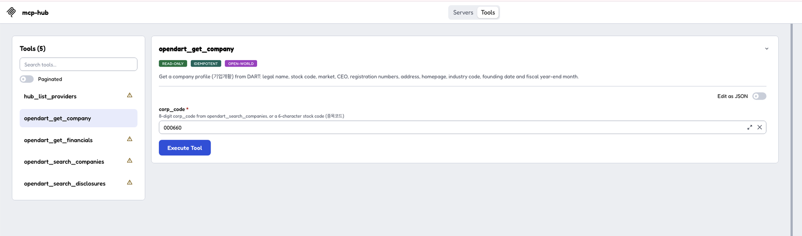
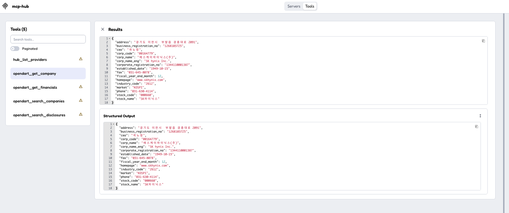
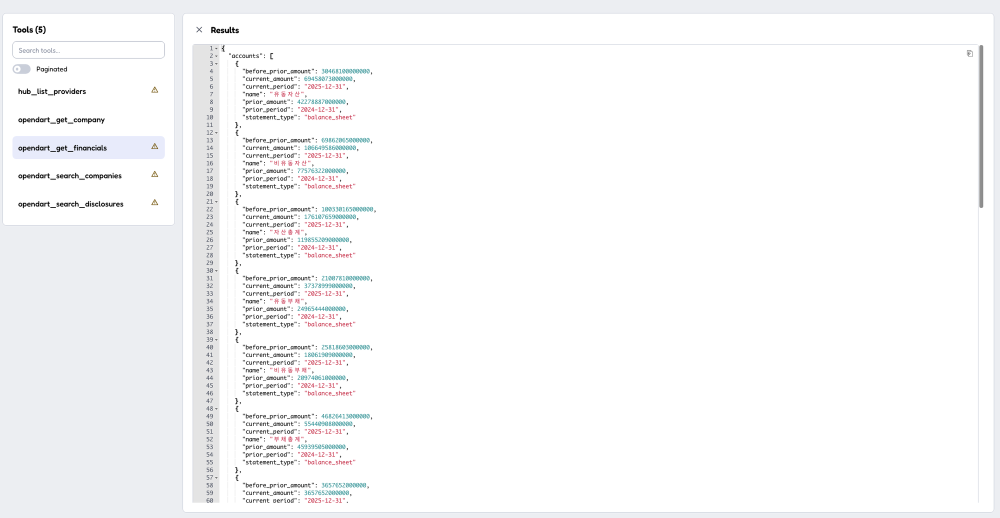

# Development

**English** | [한국어](DEVELOPMENT.ko.md)

How to build, test and debug korea-data-mcp, and how the code is organized. To add a provider or a tool, also read [CONVENTIONS.md](CONVENTIONS.md).

## Build

```sh
go build -o korea-data-mcp ./cmd/korea-data-mcp

./korea-data-mcp                            # stdio (Claude Desktop, Claude Code, etc.)
./korea-data-mcp -http 127.0.0.1:8080       # streamable HTTP
./korea-data-mcp -providers opendart        # enable only specific providers
./korea-data-mcp -env-file /abs/path/.env   # read API keys from a .env file
./korea-data-mcp -v                         # debug logs (to stderr)
```

## 1. Unit tests (no API key needed)

```sh
go test -race ./...
go test -race -v -run TestGetFinancials ./providers/opendart   # a single test
```

The tests use real upstream responses saved under each provider's `testdata/` and a fake upstream server, so they need no network or keys. Each `testdata/README.md` says which request produced each file.

## 2. MCP Inspector (call tools against the live API)

[MCP Inspector](https://github.com/modelcontextprotocol/inspector) is the official MCP debugging UI. It requires Node.js.

```sh
go build -o korea-data-mcp ./cmd/korea-data-mcp
npx @modelcontextprotocol/inspector -- ./korea-data-mcp -env-file $PWD/.env
```

> Keep the `--`. Without it, Inspector reads `-env-file` as its own `-e` option and fails with `Invalid parameter format: nv-file`.

Alternatively, run `npx @modelcontextprotocol/inspector` with no arguments and fill in the left panel: **Transport Type** `STDIO`, **Command** the absolute path to `korea-data-mcp`, **Arguments** `-env-file /absolute/path/to/.env`.

Then:

1. Click **Connect**, open the **Tools** tab, and click **List Tools**.
2. Pick a tool, fill in its inputs, and click **Execute Tool**. For example, `opendart_get_company` with `corp_code` = `000660` (SK hynix):



3. The result appears under **Results** and **Structured Output**:



4. Try the other tools the same way. For example, `opendart_get_financials` with `corp_code` = `000660` and `year` = `2025`:



Passing a company name as `corp_code` returns `INVALID_ARGUMENT` with a hint, which is a quick way to see the error format.

The first OpenDART company lookup takes a few seconds, because it downloads DART's full company list (about 120,000 entries) and builds an in-memory index. Later lookups are instant for 24 hours.

## 3. Claude Code (use it from a real agent)

```sh
claude mcp add korea-data-mcp -- /absolute/path/to/korea-data-mcp -env-file /absolute/path/to/.env
```

Start a new session, check the connection with `/mcp`, and ask a question. This shows whether an agent picks the right tools and arguments from the descriptions alone, which is what tool descriptions should be judged by.

## 4. HTTP mode

```sh
./korea-data-mcp -http 127.0.0.1:8080 -env-file /absolute/path/to/.env
```

In Inspector, set **Transport Type** to `Streamable HTTP` and the URL to `http://127.0.0.1:8080`.

The HTTP server has **no authentication**: anyone who can reach it can call the tools with your API keys. Bind it to `127.0.0.1`, not `:8080`, unless it is behind an authenticating proxy.

## 5. History collector

OpenDART forgets: ownership reports drop out of the API after about two years, a correction replaces the original, and the company list shows only today. `korea-data-collect` keeps them in a SQLite file. It calls the same tools in process, so the stored data is normalized the same way.

```sh
go build -o korea-data-collect ./cmd/korea-data-collect
./korea-data-collect -db korea-data.db -env-file .env daily               # once a day, e.g. from cron
./korea-data-collect -db korea-data.db -env-file .env -limit 2000 backfill # all listed companies, over a few days
```

- `daily`: diffs the company list (new, renamed, listed, delisted, stock code changed, removed) and stores the 5% holder and insider reports of every company with an ownership filing in the last 7 days (`-days`). A few hundred OpenDART calls.
- `backfill`: stores the reports of listed companies not collected yet, `-limit` at a time, about 3 to 4 calls each. OpenDART allows about 20,000 calls a day per key, shared with any other use of the key.
- Each run is recorded in the `run` table with its status (`ok`, `partial` when it stopped at the quota, `failed`). Reports are keyed by receipt number, so running again is safe.

## Releasing

Push a tag, and GitHub Actions ([release.yml](../.github/workflows/release.yml)) builds binaries for macOS, Linux and Windows (amd64, arm64) with [GoReleaser](https://goreleaser.com) packs them into an MCP Bundle (`korea-data-mcp.mcpb`, built by [mcpb/build.sh](../mcpb/build.sh) from [mcpb/manifest.json](../mcpb/manifest.json)), publishes everything as a GitHub release, and publishes [server.json](../server.json) to the [MCP Registry](https://registry.modelcontextprotocol.io) with the release's version and bundle hash:

```sh
git tag v0.1.0 && git push origin v0.1.0
```

To try the build locally without publishing: `goreleaser release --snapshot --clean --skip=publish` (output in `dist/`), then `mcpb/build.sh 0.0.0` for the bundle (needs Node.js and jq).

## Layout

| Path | Purpose |
|---|---|
| `hub/` | Provider registration, tool naming rules, standard errors, pagination, in-process tool calls (`Registrar.Call`) |
| `httpx/` | Upstream HTTP client (retries, caching, error mapping, API key redaction) |
| `normalize/` | Normalization of dates, amounts, company names and HTML text |
| `cache/` | In-memory TTL cache |
| `providers/` | One package per data source; `providers.go` lists them. `entity` has no source of its own: it combines the opendart and datagokr tools |
| `store/` | History database (SQLite): company list changes, ownership reports, runs |
| `collect/` | Fills the store by calling the tools in process |
| `cmd/korea-data-mcp/` | The MCP server |
| `cmd/korea-data-collect/` | The history collector |
| `docs/QUIRKS.md` | Every upstream quirk korea-data-mcp handles, with its status |

## Recording a new quirk

When an upstream API surprises you, save the real response in the provider's `testdata/` (never the request URL: it contains the key), cover it with a test, and add a row to [QUIRKS.md](QUIRKS.md) and [QUIRKS.ko.md](QUIRKS.ko.md).
